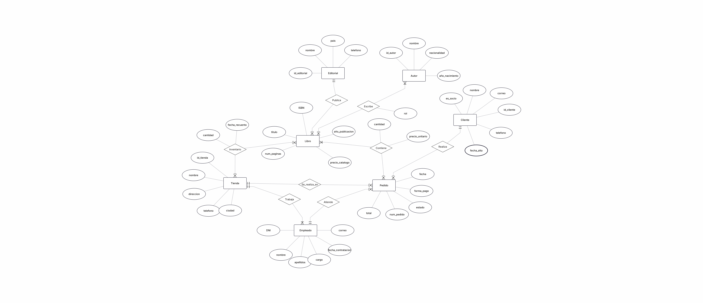

# Apartados de la base de datos

## Apartado 1. Resumen del caso

>La dueña de "Paginas de Villa Serena" nos pide ayuda con la gestion de sus productos entre\
>tiendas, necesita poder ubicar libros entre las diferentes tiendas y poder conocer de\
>ello sus cantidades por tienda, a su vez le gustaria poder encontrar libros buscando\
>simplemente por el nombre de su autor, en base al stock quiere poder saber exactamente\
>el numero de copias de cada libro y cuando fue que se conto su cantidad.\
>Ahora hablando de personal y clientes, pide ayuda para saber sus datos, del personal ademas\
>su fecha de contratacion y correo de trabajo, los clientes pueden convertise en socios\
>si lo son, se guardara tambien su telefono y la fecha en la que se dio de alta como socio.\
>Por ultimo, basandose en un ticket de ejemplo se nos pide que al revisar pedidos antiguos\
>mantengan el precio de los productos que tenian en ese entonces.

## Apartado 2. Análisis del caso

### 2.1 Entidades y atributos

| Entidad | Atributos encontrados | Fragmento del caso |
|---|---|---|
| Tienda | nombre, dirección, teléfono, ciudad | §1: cada tienda tiene su nombre, dirección, teléfono y ciudad. |
| Libro | ISBN, título, año de publicación, número de páginas, precio de catálogo | §2: datos guardados de cada libro. |
| Editorial | nombre, país, teléfono de contacto | §2: datos guardados de cada editorial. |
| Autor | nombre, nacionalidad, año de nacimiento | §2: datos guardados de cada autor. |
| Stock | tienda, libro, número de copias, fecha del último recuento | §3: el stock se controla por libro y tienda. |
| Empleado | DNI, nombre, apellidos, cargo, fecha de contratación, correo de trabajo, tienda | §4: datos de los empleados y tienda en la que trabajan. |
| Cliente | nombre completo, correo electrónico, teléfono y fecha de alta como socio | §5: todos los clientes se registran; teléfono y fecha de alta se guardan para los socios. |
| Pedido | identificador, fecha, forma de pago, estado, tienda, empleado y cliente | §6: datos del pedido que aparecen en el ticket. |
| Detalle de pedido | pedido, libro, cantidad, precio cobrado por unidad | §6: cada pedido puede incluir varios libros y se guarda el precio realmente cobrado. |

### 2.2 Relaciones

| Relación | Cardinalidad | Razonamiento |
|---|---|---|
| Editorial – Libro (`Publica`) | 1:N | Una editorial puede publicar muchos libros; cada libro pertenece a una sola editorial (§2). |
| Autor – Libro (`Escribe`) | N:M | Un autor puede escribir varios libros y un libro puede tener varios autores (§2). |
| Tienda – Libro (`Stock`) | N:M | Una tienda puede tener muchos libros y un libro puede estar en varias tiendas (§3). |
| Tienda – Empleado (`Trabaja`) | 1:N | Una tienda tiene varios empleados; cada empleado trabaja en una sola tienda (§4). |
| Cliente – Pedido (`Realiza`) | 1:N | Un cliente puede realizar varios pedidos; cada pedido corresponde a un cliente (§6). |
| Tienda – Pedido (`Se realiza en`) | 1:N | Una tienda puede gestionar muchos pedidos; cada pedido se realiza en una tienda (§6). |
| Empleado – Pedido (`Atiende`) | 1:N | Un empleado puede atender varios pedidos; cada pedido lo atiende un empleado (§6). |
| Pedido – Libro (`Contiene`) | N:M | Un pedido puede contener varios libros y un libro puede aparecer en muchos pedidos. Se resuelve con `DetallePedido` (§6). |

Las relaciones N:M se resuelven mediante las tablas intermedias `Escribe`, `Stock` y `DetallePedido`. Estas tablas guardan datos propios de la relación: tipo de autoría; copias y fecha de recuento; y cantidad y precio unitario cobrado, respectivamente.

### 2.3 Datos descartados

| Dato | Motivo |
|---|---|
| Total del pedido | Se puede calcular sumando `cantidad * precio_unitario` de sus líneas. |
| Nombre de la editorial dentro de `Libro` como texto repetido | Se guarda una referencia a la tabla `Editorial`, evitando repetir sus datos en cada libro. |
| Nombre del autor dentro de `Libro` como texto único | Un libro puede tener varios autores; se utiliza `Escribe` para relacionarlos. |
| Stock como una única columna en `Libro` | El stock depende de la tienda y del libro, por lo que se guarda en `Stock`. |
| Precio histórico tomado del catálogo actual | No sirve para pedidos antiguos; el precio cobrado se guarda en `DetallePedido`. |
| Historial de cambios de tienda de los empleados | El caso indica que no hace falta conservarlo; solo se guarda la tienda actual. |

### Preguntas A Responder

- ¿Qué libros tiene la tienda Centro y cuántas copias quedan?
- ¿Cuál es el libro más vendido en cada tienda?
- ¿Cuánto ha facturado cada tienda este año?
- ¿Qué clientes han hecho más de dos pedidos?
- ¿Qué libros están agotados en una tienda pero disponibles en otra?
- ¿Qué empleado ha atendido más pedidos?
- ¿Qué autores tienen libros en más de una editorial?

## Notas Gestora

### lo que no queremos tener al final

| Libro | Autor | Editorial | Precio | Stock | Contado el |
|---|---|---|---|---|---|
| Rayuela | Julio Cortázar | Alfaguara | 16,50 | 4 | 02/03/2026 |
| Ficciones | Jorge Luis Borges | Alianza | 12,00 | 2 | 02/03/2026 |
| Cuentos de Eva Luna | Isabel Allende | Plaza & Janés | 14,90 | 0 | 02/03/2026 |
| Antología del cuento | Cortázar / Borges | Alianza | 18,00 | 6 | 28/02/2026 |

>"algunos libros tienen más de un autor"

## 3. Reglas de negocio

1. Cada tienda tiene un identificador y un nombre, dirección, teléfono y ciudad.
2. Cada libro se identifica por un ISBN de 13 cifras.
3. Cada libro pertenece a una sola editorial; una editorial puede publicar varios libros.
4. Un libro puede tener varios autores y un autor puede escribir varios libros.
5. Para cada relación entre un libro y un autor se indica si su participación es principal o colaboradora.
6. El stock se registra para cada combinación de tienda y libro e incluye el número de copias y la fecha del último recuento.
7. Si un libro no está registrado en una tienda, no existe una fila de stock para esa combinación.
8. Cada empleado trabaja en una sola tienda. Si cambia de tienda, se actualiza su tienda asignada y no se conserva el historial.
9. El correo electrónico de cada cliente es único.
10. Los clientes que no son socios también se registran con nombre completo y correo electrónico.
11. El teléfono y la fecha de alta como socio pueden quedar vacíos cuando el cliente no es socio.
12. Cada pedido pertenece a un cliente, se realiza en una tienda y lo atiende un empleado.
13. La forma de pago de un pedido será efectivo, tarjeta o bizum.
14. El estado de un pedido será preparado, entregado o cancelado.
15. Un pedido puede incluir varios libros y cada línea guarda la cantidad de unidades.
16. Cada línea de pedido guarda el precio unitario cobrado en ese momento, que no cambia si se modifica el precio del catálogo.
17. Las cantidades y los precios no pueden ser negativos.

## Apartado 4. Diagrama Entidad-Relacion



| Relación | Tipo | Cómo se resuelve |
|---|---|---|
| Editorial – Libro | 1:N | `Libro.id_editorial` referencia `Editorial.id_editorial`. |
| Autor – Libro | N:M | Tabla intermedia `Escribe`, con el atributo `tipo_autoria`. |
| Tienda – Libro | N:M | Tabla intermedia `Stock`, con `copias` y `fecha_conteo`. |
| Tienda – Empleado | 1:N | `Empleado.id_tienda` referencia `Tienda.id_tienda`. |
| Cliente – Pedido | 1:N | `Pedido.id_cliente` referencia `Cliente.id_cliente`. |
| Tienda – Pedido | 1:N | `Pedido.id_tienda` referencia `Tienda.id_tienda`. |
| Empleado – Pedido | 1:N | `Pedido.dni` referencia `Empleado.dni`. |
| Pedido – Libro | N:M | Tabla intermedia `DetallePedido`, con `cantidad` y `precio_unitario`. |

## 5. Modelo lógico

### `Tienda`

| Columna | Clave | Referencia |
|---|---|---|
| `id_tienda` | PK | |
| `nombre` | | |
| `direccion` | | |
| `telefono` | | |
| `ciudad` | | |

### `Editorial`

| Columna | Clave | Referencia |
|---|---|---|
| `id_editorial` | PK | |
| `nombre` | | |
| `pais` | | |
| `telefono` | | |

### `Libro`

| Columna | Clave | Referencia |
|---|---|---|
| `isbn` | PK | |
| `titulo` | | |
| `anio_publicacion` | | |
| `numero_paginas` | | |
| `precio_catalogo` | | |
| `id_editorial` | FK | `Editorial.id_editorial` |

### `Autor`

| Columna | Clave | Referencia |
|---|---|---|
| `id_autor` | PK | |
| `nombre` | | |
| `nacionalidad` | | |
| `anio_nacimiento` | | |

### `Escribe`

| Columna | Clave | Referencia |
|---|---|---|
| `isbn` | PK, FK | `Libro.isbn` |
| `id_autor` | PK, FK | `Autor.id_autor` |
| `tipo_autoria` | | |

### `Stock`

| Columna | Clave | Referencia |
|---|---|---|
| `id_tienda` | PK, FK | `Tienda.id_tienda` |
| `isbn` | PK, FK | `Libro.isbn` |
| `copias` | | |
| `fecha_conteo` | | |

### `Empleado`

| Columna | Clave | Referencia |
|---|---|---|
| `dni` | PK | |
| `nombre` | | |
| `apellidos` | | |
| `cargo` | | |
| `fecha_contratacion` | | |
| `correo_trabajo` | | |
| `id_tienda` | FK | `Tienda.id_tienda` |

### `Cliente`

| Columna | Clave | Referencia |
|---|---|---|
| `id_cliente` | PK | |
| `nombre_completo` | | |
| `correo` | UNIQUE | |
| `telefono` | | |
| `fecha_alta` | | |

### `Pedido`

| Columna | Clave | Referencia |
|---|---|---|
| `id_pedido` | PK | |
| `dni` | FK | `Empleado.dni` |
| `id_cliente` | FK | `Cliente.id_cliente` |
| `id_tienda` | FK | `Tienda.id_tienda` |
| `fecha` | | |
| `forma_pago` | | |
| `estado` | | |

### `DetallePedido`

| Columna | Clave | Referencia |
|---|---|---|
| `id_pedido` | PK, FK | `Pedido.id_pedido` |
| `isbn` | PK, FK | `Libro.isbn` |
| `cantidad` | | |
| `precio_unitario` | | |

## 6. Script SQL (`schema.sql`)

El archivo `schema.sql` contiene las instrucciones `CREATE DATABASE`, `USE` y `CREATE TABLE` para describir la estructura en MySQL. El archivo adicional `datos_prueba.sql` incluye ejemplos ficticios de registros. Aunque no sea necesario ejecutar una base de datos funcional para este caso, ambos archivos muestran cómo se crearían las tablas y cómo se relacionarían los datos.

```sql
CREATE DATABASE IF NOT EXISTS libreria
    CHARACTER SET utf8mb4 COLLATE utf8mb4_unicode_ci;
USE libreria;

CREATE TABLE Tienda (
    id_tienda INT AUTO_INCREMENT PRIMARY KEY,
    nombre    VARCHAR(60)  NOT NULL,
    direccion VARCHAR(120) NOT NULL,
    telefono  VARCHAR(15)  NOT NULL,
    ciudad    VARCHAR(60)  NOT NULL
);

CREATE TABLE Editorial (
    id_editorial INT AUTO_INCREMENT PRIMARY KEY,
    nombre       VARCHAR(100) NOT NULL,
    pais         VARCHAR(60)  NOT NULL,
    telefono     VARCHAR(15)
);

CREATE TABLE Libro (
    isbn             CHAR(13) PRIMARY KEY,
    titulo           VARCHAR(150) NOT NULL,
    anio_publicacion SMALLINT     NOT NULL,
    numero_paginas   SMALLINT     NOT NULL,
    precio_catalogo  DECIMAL(8,2) NOT NULL,
    id_editorial     INT          NOT NULL,
    CONSTRAINT fk_libro_editorial FOREIGN KEY (id_editorial)
        REFERENCES Editorial (id_editorial),
    CONSTRAINT ck_libro_paginas CHECK (numero_paginas > 0),
    CONSTRAINT ck_libro_precio  CHECK (precio_catalogo >= 0)
);

CREATE TABLE Autor (
    id_autor        INT AUTO_INCREMENT PRIMARY KEY,
    nombre          VARCHAR(100) NOT NULL,
    nacionalidad    VARCHAR(60),
    anio_nacimiento SMALLINT
);

CREATE TABLE Escribe (
    isbn         CHAR(13) NOT NULL,
    id_autor     INT      NOT NULL,
    tipo_autoria ENUM('principal', 'colaborador') NOT NULL,
    PRIMARY KEY (isbn, id_autor),
    CONSTRAINT fk_escribe_libro FOREIGN KEY (isbn)     REFERENCES Libro (isbn),
    CONSTRAINT fk_escribe_autor FOREIGN KEY (id_autor) REFERENCES Autor (id_autor)
);

CREATE TABLE Stock (
    id_tienda    INT      NOT NULL,
    isbn         CHAR(13) NOT NULL,
    copias       INT      NOT NULL,
    fecha_conteo DATE     NOT NULL,
    PRIMARY KEY (id_tienda, isbn),
    CONSTRAINT fk_stock_tienda FOREIGN KEY (id_tienda) REFERENCES Tienda (id_tienda),
    CONSTRAINT fk_stock_libro  FOREIGN KEY (isbn)      REFERENCES Libro (isbn),
    CONSTRAINT ck_stock_copias CHECK (copias >= 0)
);

CREATE TABLE Empleado (
    dni                CHAR(9) PRIMARY KEY,
    nombre             VARCHAR(60)  NOT NULL,
    apellidos          VARCHAR(100) NOT NULL,
    cargo              VARCHAR(60)  NOT NULL,
    fecha_contratacion DATE         NOT NULL,
    correo_trabajo     VARCHAR(100) NOT NULL,
    id_tienda          INT          NOT NULL,
    CONSTRAINT fk_empleado_tienda FOREIGN KEY (id_tienda) REFERENCES Tienda (id_tienda)
);

CREATE TABLE Cliente (
    id_cliente      INT AUTO_INCREMENT PRIMARY KEY,
    nombre_completo VARCHAR(150) NOT NULL,
    correo          VARCHAR(100) NOT NULL UNIQUE,
    telefono        VARCHAR(15)  NULL,
    fecha_alta      DATE         NULL
);

CREATE TABLE Pedido (
    id_pedido  INT AUTO_INCREMENT PRIMARY KEY,
    dni        CHAR(9)  NOT NULL,
    id_cliente INT      NOT NULL,
    id_tienda  INT      NOT NULL,
    fecha      DATETIME NOT NULL,
    forma_pago ENUM('efectivo', 'tarjeta', 'bizum') NOT NULL,
    estado     ENUM('preparado', 'entregado', 'cancelado') NOT NULL,
    CONSTRAINT fk_pedido_empleado FOREIGN KEY (dni)        REFERENCES Empleado (dni),
    CONSTRAINT fk_pedido_cliente  FOREIGN KEY (id_cliente) REFERENCES Cliente (id_cliente),
    CONSTRAINT fk_pedido_tienda   FOREIGN KEY (id_tienda)  REFERENCES Tienda (id_tienda)
);

CREATE TABLE DetallePedido (
    id_pedido       INT          NOT NULL,
    isbn            CHAR(13)     NOT NULL,
    cantidad        INT          NOT NULL,
    precio_unitario DECIMAL(8,2) NOT NULL,
    PRIMARY KEY (id_pedido, isbn),
    CONSTRAINT fk_detalle_pedido FOREIGN KEY (id_pedido) REFERENCES Pedido (id_pedido),
    CONSTRAINT fk_detalle_libro  FOREIGN KEY (isbn)      REFERENCES Libro (isbn),
    CONSTRAINT ck_detalle_cantidad CHECK (cantidad > 0),
    CONSTRAINT ck_detalle_precio   CHECK (precio_unitario >= 0)
);
```

## 7. Diccionario de datos

### `Tienda`

| Columna | Tipo | Nulo | Descripción |
|---|---|---|---|
| `id_tienda` | INT, autoincremental | No | Identificador de la tienda (PK). |
| `nombre` | VARCHAR(60) | No | Nombre comercial: Centro, Ribera o Universidad. |
| `direccion` | VARCHAR(120) | No | Dirección postal. |
| `telefono` | VARCHAR(15) | No | Teléfono de la tienda. |
| `ciudad` | VARCHAR(60) | No | Ciudad o pueblo donde está (Ribera está en Aldeaverde). |

## 8. Decisiones de diseño
## 9. Datos de prueba
## 10. Consultas de prueba
## 11. Limitaciones y mejoras futuras